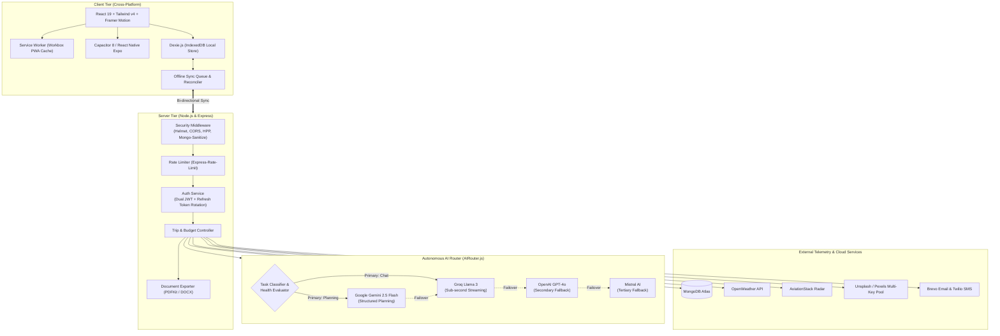
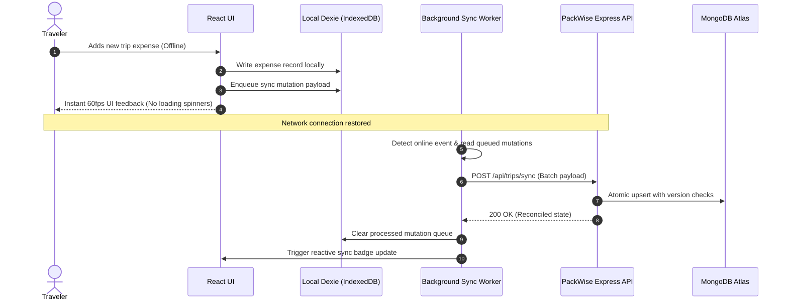

<div align="center">


# PackWise AI

### Autonomous Travel Operating System & Multi-LLM Itinerary Intelligence

[](https://github.com/Thranae/packwise/actions/workflows/ci.yml)
[](https://opensource.org/licenses/MIT)
[](https://react.dev/)
[](https://vitejs.dev/)
[](https://nodejs.org/)
[](https://ai.google.dev/)
[](https://dexie.org/)
[](https://capacitorjs.com/)
[](https://www.mongodb.com/)

<p align="center">
  <b>PackWise</b> is an enterprise-grade, offline-first autonomous travel companion engineered for unpredictable real-world connectivity. Powered by a self-healing multi-LLM orchestrator, high-performance 3D spatial mapping, and cross-platform native execution across Web, iOS, and Android.
</p>

[Key Features](#-key-features) • [System Architecture](#-system-architecture) • [Offline-First Engine](#-offline-first-data-engine) • [Multi-LLM Router](#-multi-llm-orchestrator) • [Monorepo Layout](#-monorepo-structure) • [Quick Start](#-quick-start)

---

</div>

## 🌟 Key Features

| Capability | Engineering Highlights |
| :--- | :--- |
| **Autonomous Itinerary Generation** | Schema-enforced itinerary generation powered by Google Gemini 2.5 Flash, generating hour-by-hour schedules, local culinary highlights, geo-tagged activities, and automated packing lists. |
| **Resilient Multi-LLM Router** | Zero-downtime AI architecture with intelligent task routing (Gemini 2.5 Flash &rarr; Groq Llama 3 &rarr; OpenAI &rarr; Mistral &rarr; OpenRouter) equipped with exponential backoff and circuit-breaker fallbacks. |
| **Offline-First Data Layer** | Full client-side IndexedDB persistence via Dexie.js. Users can generate, view, edit trips, check off packing items, and log expenses without an active internet connection. Background Sync automatically reconciles state once connectivity resumes. |
| **3D Spatial & Interactive Canvas** | Immersive WebGL interfaces including real-time Three.js globes, interactive MapLibre / Leaflet satellite mapping, and Spline 3D assets running at 60 FPS. |
| **Hardened Security Suite** | Dual-token authentication with rotating JWT refresh tokens stored in HttpOnly, SameSite cookies, bcrypt password hashing, MongoDB query sanitization, and strict Helmet Content Security Policies. |
| **Universal Cross-Platform** | Single codebase ecosystem spanning progressive web app (PWA), native iOS and Android builds via Capacitor 8, alongside a companion React Native Expo mobile workspace. |
| **Itinerary Export Engine** | Server-side PDF and DOCX generation with custom brand typography, budget summaries, packing manifests, and QR trip sharing. |

---

## 🏛️ System Architecture

PackWise employs a decoupled client-gateway topology designed for fault-tolerance, low-latency client rendering, and seamless cloud synchronization.



---

## 📶 Offline-First Data Engine

Travelers frequently encounter dead zones, subway tunnels, and international roaming limits. PackWise is built on an **offline-first local-store architecture**:

1. **Local-First Mutations**: Every trip modification, expense log, and packing check-off writes instantly to the client's Dexie.js (IndexedDB) database for sub-10ms UI updates.
2. **Deterministic Mutation Queue**: Offline actions are appended to an indexed operation log (`offlineSyncQueue`) with idempotency keys.
3. **Background Reconciliation**: When the browser or native app detects the `online` window event, the synchronization service pushes queued actions to the server, reconciles conflict timestamps, and updates remote MongoDB documents.



---

## 🧠 Multi-LLM Orchestrator

Rather than relying on a single AI provider prone to rate limits and outages, PackWise features a custom `AIRouter`:

- **Smart Task Specialization**: Directs high-complexity itinerary structuring to **Google Gemini 2.5 Flash** for strict JSON output compliance, while routing conversational chat to **Groq** for sub-300ms time-to-first-token streaming.
- **Self-Healing Fallback Chains**: If an endpoint returns a `429 Too Many Requests` or `5xx Server Error`, the router immediately transitions to the next healthy provider in the chain without failing the user request.
- **Dynamic API Key Cycling**: Rotates API keys across multi-key pools (Pexels, Unsplash, Pixabay) to prevent quota exhaustion.

---

## 📁 Monorepo Structure

```text
packwise/
├── client/                     # Web Application & Capacitor Container
│   ├── src/
│   │   ├── components/         # Modular UI (Widgets, 3D Canvas, Navigation)
│   │   ├── contexts/           # AuthContext, TripContext (Dexie integrated)
│   │   ├── db/                 # Dexie.js IndexedDB schema & sync stores
│   │   ├── hooks/              # Custom hooks (useLiveApis, useDestinationImage)
│   │   └── utils/              # CostEngine, currency localizers, PDF generator
│   ├── public/                 # PWA icons, WebGL assets, Web Manifest
│   ├── capacitor.config.json   # Native iOS & Android runtime config
│   └── vite.config.js          # Optimized Rollup chunking & PWA service worker
├── server/                     # Backend API & Orchestration Gateway
│   ├── controllers/            # Trip, Auth, SMS, Weather, Image controllers
│   ├── middleware/             # Rate limit, JWT verification, error boundary
│   ├── models/                 # Mongoose schemas (Trip, User, Notification)
│   ├── routes/                 # Express API routes
│   ├── services/
│   │   ├── ai/                 # AIRouter, ProviderManager, Multi-LLM fallbacks
│   │   ├── token.service.js    # Dual JWT access/refresh token rotation
│   │   └── tripScore.service.js# Weather and contextual trip scoring
│   └── server.js               # Entry point with graceful shutdown
├── packwise-mobile/            # Companion React Native Expo Application
│   ├── src/
│   │   ├── app/                # Expo Router file-based screen routes
│   │   ├── components/         # Reanimated cards, glassmorphic HUDs
│   │   └── store/              # Zustand state management
│   └── app.json                # Expo mobile manifest
└── .github/                    # CI/CD Workflows & Dependabot
    └── workflows/ci.yml        # Automated build & syntax validation
```

---

## 🚀 Quick Start

### Prerequisites
- **Node.js**: `v20.0.0` or higher
- **npm**: `v10.0.0` or higher
- **MongoDB**: Local instance running on `localhost:27017` or a MongoDB Atlas URI

### 1. Clone the Repository
```bash
git clone https://github.com/Thranae/packwise.git
cd packwise
```

### 2. Install All Dependencies
Install dependencies for both frontend and backend in one command:
```bash
npm run install:all
```

### 3. Configure Environment Variables
Create your local environment files:

```bash
# Server configuration
cp server/.env.example server/.env

# Client configuration
cp .env.example client/.env
```

Ensure at least `MONGO_URI`, `JWT_SECRET`, and `GEMINI_API_KEY` are populated in `server/.env`.

### 4. Run the Full Stack Development Server
Run both client and server concurrently with live hot-reloading:
```bash
npm run dev
```

- Web Client: [http://localhost:5173](http://localhost:5173)
- API Server: [http://localhost:5000](http://localhost:5000)

---

## 📱 Mobile Development

### Capacitor (Native iOS & Android Container)
```bash
cd client
npm run build
npx cap sync
npx cap open android   # Opens Android Studio
npx cap open ios       # Opens Xcode (macOS only)
```

### React Native Expo
```bash
cd packwise-mobile
npm install
npx expo start
```

---

## 🔒 Security Hardening

- **HttpOnly Cookie Storage**: Refresh tokens are isolated from JavaScript execution to prevent XSS credential theft.
- **CSRF & Injection Mitigation**: Express uses `express-mongo-sanitize` to strip prohibited characters from inputs and query objects.
- **Strict Headers**: Configured with `helmet` providing Content Security Policy (CSP), DNS prefetch controls, and frameguard protections.
- **Strict Rate Limiting**: Sensitive endpoints (authentication, AI generation) are guarded against brute-force and DDoS attempts.

---

## 📄 License

This project is licensed under the [MIT License](LICENSE) — see the LICENSE file for details.

---

<div align="center">
  <sub>Engineered by <b>Thranaeswanth S</b>. Star ⭐ this repository if you find the architecture helpful!</sub>
</div>
