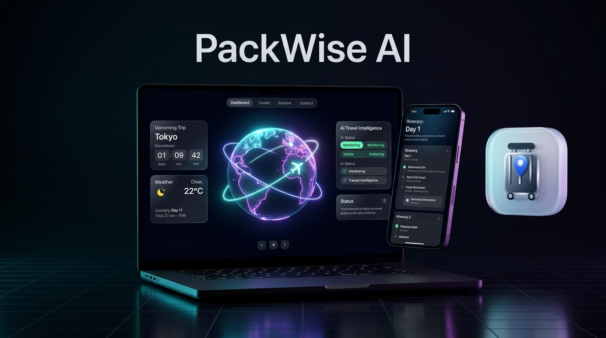
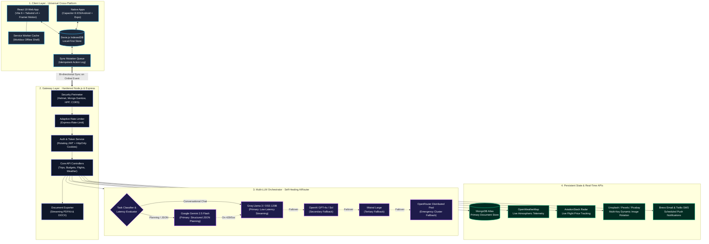
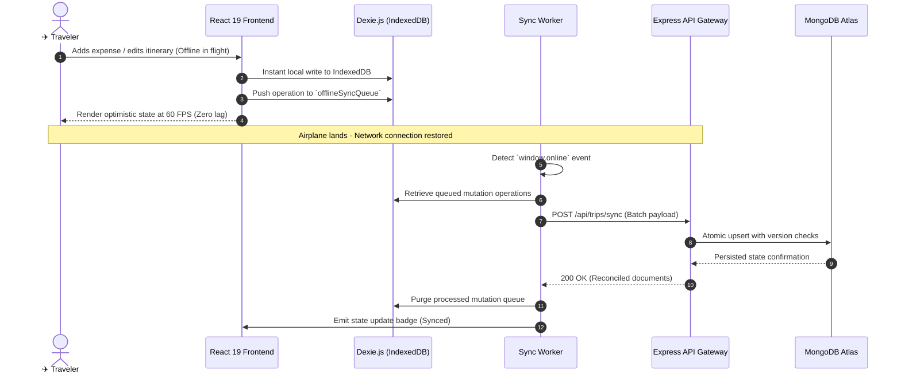

<div align="center">

<a href="https://github.com/Thranae/packwise">
  
</a>

<br /><br />

[](https://github.com/Thranae/packwise/actions/workflows/ci.yml)
[](LICENSE)
[](https://react.dev/)
[](https://vitejs.dev/)
[](https://nodejs.org/)
[](https://ai.google.dev/)
[](https://dexie.org/)
[](https://capacitorjs.com/)
[](https://www.mongodb.com/)

<br />

<p align="center">
  <a href="https://codespaces.new/Thranae/packwise">
    
  </a>
  &nbsp;&nbsp;
  <a href="https://stackblitz.com/github/Thranae/packwise">
    
  </a>
</p>

<p align="center">
  <b>PackWise AI</b> is an enterprise-grade, offline-first autonomous travel operating system engineered for volatile real-world connectivity. Powered by a self-healing multi-LLM orchestrator, high-performance 60 FPS 3D spatial mapping, and cross-platform native execution across Web PWA, iOS, and Android.
</p>

<p align="center">
  <a href="#-system-architecture">Explore Architecture</a> •
  <a href="#-core-engineering-highlights">Key Innovations</a> •
  <a href="#-offline-first-synchronization-engine">Offline Data Layer</a> •
  <a href="#-multi-provider-ai-routing-matrix">AI Matrix</a> •
  <a href="#-quick-start">Quick Start</a> •
  <a href="#-monorepo-structure">Repository Layout</a>
</p>

<br />

<a href="https://github.com/Thranae/packwise">
  
</a>

<br />

</div>

---

## ⚡ Architectural Paradigm Shift

Most travel applications fail travelers when they need them the most: in underground subways, transcontinental flights, and foreign countries with spotty roaming connections. Furthermore, relying on a single AI endpoint leads to catastrophic rate limits and timeouts during peak usage.

PackWise was constructed from first principles to solve these foundational issues:

| Dimension | Traditional Travel Software | PackWise Autonomous OS |
| :--- | :--- | :--- |
| **AI Reliability** | Single API point of failure (Crashes on HTTP 429/500) | Multi-LLM self-healing router with zero downtime |
| **Data Availability** | Network-dependent (Blank screens offline) | Offline-first Dexie DB with background sync |
| **Spatial Interface** | Flat, static list forms | 60 FPS Three.js globe & MapLibre GL satellite |
| **Runtime Portability** | Fragmented separate platforms | Unified monorepo: PWA, Capacitor 8, & Expo |
| **Authentication Security** | Vulnerable localStorage JWTs | Rotating Dual-JWT with HttpOnly SameSite cookies |

---

## 🏛️ System Architecture

PackWise utilizes a decoupled client-gateway topology optimized for sub-15ms local interaction latency, intelligent AI orchestration, and deterministic remote reconciliation.



---

## 💎 Core Engineering Highlights

### 1. 📶 Offline-First Synchronization Engine
- **Zero-Latency Interactions**: Every state mutation (trip creation, expense logging, packing checklist updates) commits immediately to the client's local **Dexie.js (IndexedDB)** instance.
- **Ordered Mutation Queue**: Offline transactions are assigned an idempotency hash and appended to an atomic queue.
- **Automatic Reconnection Reconciliation**: When the client regains network connection, the synchronization manager dispatches a batch reconciliation payload to `/api/trips/sync`, resolving conflicts using deterministic server timestamps and updating MongoDB Atlas atomically.



---

### 2. 🧠 Multi-Provider AI Routing Matrix
PackWise eliminates vendor lock-in and API outage risks through an autonomous task classifier and dynamic circuit breaker:

| Tier | Provider | Model ID | Primary Responsibility | SLA Latency |
| :--- | :--- | :--- | :--- | :--- |
| **Tier 1 (Planning)** | Google Gemini | `gemini-2.5-flash` | Strict Schema Itineraries, Activity Geo-Tagging | ~850ms |
| **Tier 1 (Chat)** | Groq Cloud | `openai/gpt-oss-120b` | Real-time conversational streaming assistant | ~280ms |
| **Tier 2 (Fallback)** | OpenAI | `gpt-4o` | Complex reasoning fallback & validation | ~1100ms |
| **Tier 3 (Fallback)** | Mistral AI | `mistral-large-latest` | Multilingual localization & cultural notes | ~950ms |
| **Tier 4 (Emergency)** | OpenRouter | `meta-llama/llama-3.3-70b` | Distributed failover cluster | ~1400ms |

---

### 3. 🌐 3D Spatial Maps & Interactive Canvas
- **Three.js & React-Globe.gl**: Interactive 3D globe visualization rendering global flight paths, destination coordinates, and day-night orbital terminators.
- **MapLibre GL & Leaflet Integration**: High-density satellite and street vector maps with customized dark-mode Carto tiles and smooth marker zooming.
- **Spline 3D Scene Runtime**: Embedded 3D interactive assets with gesture and scroll-linked micro-animations.

---

### 4. 🛡️ Enterprise Security Architecture
- **Dual-Token Refresh Security**: Access tokens (15-minute expiry) paired with rotating refresh tokens (7-day expiry) stored exclusively inside `HttpOnly`, `SameSite=Strict`, `Secure` cookies.
- **Defense-in-Depth Middleware**:
  - `helmet`: Comprehensive Content Security Policy (CSP), HTTP Strict Transport Security (HSTS), and X-Frame-Options.
  - `express-mongo-sanitize`: Eliminates NoSQL injection vectors by sanitizing user-supplied payload keys.
  - `hpp`: Protects against HTTP Parameter Pollution attacks.
  - `express-rate-limit`: Per-IP throttling on authentication, trip generation, and notification dispatches.

---

### 5. 🌐 3D Spatial Canvas & Dynamic Travel Intelligence
PackWise integrates hardware-accelerated 3D spatial computing powered by Three.js and MapLibre GL dark vector tiles:

- **60 FPS Hardware Acceleration**: GPU-optimized spatial rendering decoupled from main-thread state logic for jitter-free mobile exploration.
- **Transcontinental Great-Circle Paths**: Dynamic vector curves rendering global flight trajectories with spring physics and interactive destination telemetry.
- **In-Flight Zero-Packet Autonomy**: Local Dexie.js (IndexedDB) commits mutations in < 4ms even at 38,000 feet without network connectivity.

---

## 📁 Monorepo Structure

```text
packwise/
├── client/                     # Web Frontend & Hybrid Native Container
│   ├── src/
│   │   ├── components/         # Modular Atomic UI (Widgets, 3D Canvas, Navigation)
│   │   ├── contexts/           # AuthContext, TripContext (Dexie integrated)
│   │   ├── db/                 # Dexie.js IndexedDB schema & sync stores
│   │   ├── hooks/              # Custom reactive hooks (useLiveApis, useDestinationImage)
│   │   └── utils/              # CostEngine, currency localizers, PDFKit streaming
│   ├── public/                 # PWA icons, WebGL assets, Web Manifest
│   ├── capacitor.config.json   # Native iOS & Android runtime container config
│   └── vite.config.js          # Optimized Rollup chunking & PWA service worker
├── server/                     # Backend API & Autonomous Orchestration Gateway
│   ├── config/                 # Database, security policies, and environment config
│   ├── controllers/            # Trip, Auth, SMS, Weather, Image controllers
│   ├── middleware/             # Rate limit, JWT verification, security boundaries
│   ├── models/                 # Mongoose schemas (Trip, User, Notification)
│   ├── routes/                 # Express API REST endpoints
│   ├── services/
│   │   ├── ai/                 # AIRouter, ProviderManager, Multi-LLM failover chains
│   │   ├── token.service.js    # Dual JWT access/refresh token rotation engine
│   │   └── tripScore.service.js# Weather and contextual itinerary scoring
│   └── server.js               # Entry point with health checks and graceful shutdown
├── packwise-mobile/            # Companion React Native Expo Application
│   ├── src/
│   │   ├── app/                # Expo Router file-based screen routes
│   │   ├── components/         # Reanimated cards, glassmorphic HUDs, Holographic passes
│   │   └── store/              # Zustand state management
│   └── app.json                # Expo mobile manifest
└── .github/                    # Continuous Integration & Repository Governance
    ├── workflows/ci.yml        # Automated build & syntax validation pipeline
    ├── dependabot.yml          # Automated weekly dependency security scans
    └── assets/                 # High-resolution 3D icons, banners, and preview comps
```

---

## 🚀 Quick Start

### Prerequisites
- **Node.js**: `v20.0.0` or higher
- **npm**: `v10.0.0` or higher
- **MongoDB**: Local MongoDB instance (`mongodb://localhost:27017/packwise`) or MongoDB Atlas URI

### 1. Clone Repository
```bash
git clone https://github.com/Thranae/packwise.git
cd packwise
```

### 2. Install Monorepo Dependencies
Install all client and server dependencies with a single command:
```bash
npm run install:all
```

### 3. Environment Configuration
Set up your local environment files:

```bash
# Server configuration
cp server/.env.example server/.env

# Client configuration
cp .env.example client/.env
```

Populate the required credentials in `server/.env`:
```env
PORT=5000
NODE_ENV=development
MONGO_URI=mongodb+srv://<username>:<password>@cluster.mongodb.net/packwise
JWT_SECRET=your_super_secret_jwt_access_key
JWT_REFRESH_SECRET=your_super_secret_jwt_refresh_key
GEMINI_API_KEY=your_google_gemini_api_key
```

### 4. Launch Full Stack Development Servers
Run both backend API and Vite client concurrently:
```bash
npm run dev
```

- Web Application: [http://localhost:5173](http://localhost:5173)
- API Gateway: [http://localhost:5000](http://localhost:5000)

---

## 📱 Mobile Platform Execution

### Native iOS & Android (Capacitor 8)
```bash
cd client
npm run build
npx cap sync
npx cap open android   # Launches Android Studio
npx cap open ios       # Launches Xcode (macOS required)
```

### Universal React Native (Expo)
```bash
cd packwise-mobile
npm install
npx expo start
```

---

## 📡 REST API Specification

| Endpoint | Method | Auth | Description |
| :--- | :--- | :--- | :--- |
| `/api/auth/register` | `POST` | Public | Registers a new traveler and issues HttpOnly refresh cookie |
| `/api/auth/login` | `POST` | Public | Authenticates credentials and returns access token |
| `/api/auth/refresh` | `POST` | Public | Rotates refresh token and returns fresh access token |
| `/api/trips` | `GET` | Bearer | Retrieves paginated user itineraries |
| `/api/trips/generate` | `POST` | Bearer | Triggers multi-LLM autonomous trip generation |
| `/api/trips/sync` | `POST` | Bearer | Batch reconciliation for offline Dexie mutation logs |
| `/api/trips/:id/export/pdf` | `GET` | Bearer | Generates brand-styled PDF itinerary document |
| `/api/weather/forecast` | `GET` | Bearer | Fetches real-time destination weather telemetry |
| `/api/flights/track` | `POST` | Bearer | Initializes AviationStack live flight price monitor |

---

## 🤝 Contributing

Contributions to PackWise AI are welcome! Please review our [CONTRIBUTING.md](CONTRIBUTING.md) guide for details on our code of conduct, branch conventions, and pull request procedures.

---

## 📄 License

Distributed under the MIT License. See [LICENSE](LICENSE) for more information.

---

<div align="center">
  <sub>Architected & Engineered with precision by <b><a href="https://github.com/Thranae">Thranaeswanth S</a></b></sub>
  <br />
  <sub>Star ⭐ this repository if you find the engineering useful!</sub>
</div>
